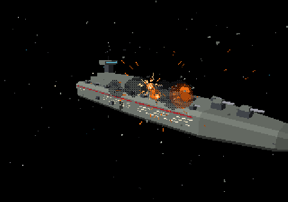
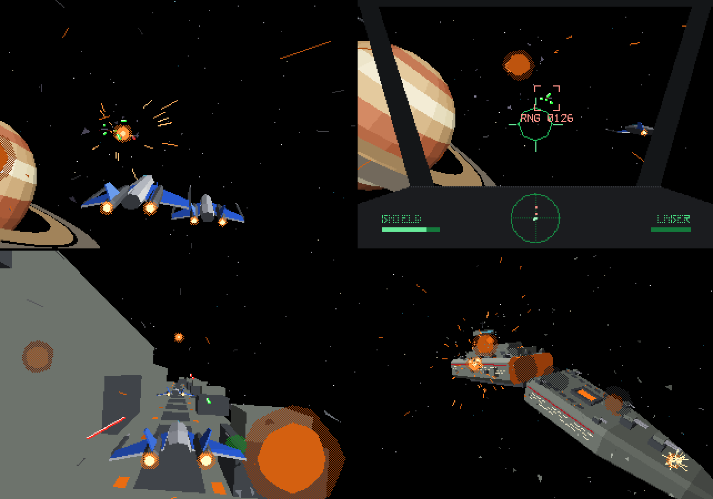

# SPACE.cob

**DATA DIVISION**: a 100-second flat-shaded polygon space demo with a
synthesised soundtrack, written in COBOL and compiled with
[yaccc](https://github.com/luckyseoul/yaccc).



A fighter squadron, a dogfight, a cockpit pass, a strafing run down the deck
of a capital ship, the ship coming apart, an aftermath pass over the wreck,
and an end card over the ringed giant — in the style of the 32X / Saturn era.
There are no controls: it is a scripted attract-mode film.

The program draws every frame itself (transform, clipping, lighting, polygon
fill, sprites, particles, the HUD and the vector font) and writes raw frames
to standard output. It also synthesises its own soundtrack: every video frame
produces 735 samples of 16-bit mono audio. The track is weapons only — cannon
reports and blast thumps, and silence everywhere else. No engines, no music,
nothing under the picture. ffmpeg only encodes both streams.

The whole film: [space.mp4](https://github.com/luckyseoul/SPACE.cob/releases/download/v1.0/space.mp4)
(1280×896, 30 fps, 100 s, with sound, 9.7 MB). Or render it yourself in a
couple of minutes with `./render.sh`.



## Requirements

- [yaccc](https://github.com/luckyseoul/yaccc), which needs Python 3.11+ and gcc or clang
- ffmpeg, and ffplay for `play.sh` (which muxes the film before playing it)
- numpy and scipy, only to regenerate `models.dat`

## Run

```
./render.sh          # builds ./space and writes space.mp4
./play.sh            # builds ./space and plays it live in ffplay
```

If `yaccc` is not on your PATH, set `YACCC` to the launcher in your yaccc
clone.

By hand:

```
yaccc space.cob
DEMO_AUDIO=space.pcm ./space > /dev/null          # pass 1: the soundtrack
./space | ffmpeg -f rawvideo -pixel_format gbrp -video_size 320x224 \
    -framerate 30 -i - -f s16le -ar 22050 -ac 1 -i space.pcm \
    -c:v libx264 -crf 18 -c:a aac -shortest space.mp4
```

Two passes, because ffmpeg has to see a complete file when it opens the audio
input; the second pass re-simulates the film to pipe the frames, and produces
the same bytes, which is what keeps the two streams in step. `render.sh` and
`play.sh` do this for you.

`DEMO_START` (first frame to output) and `DEMO_FRAMES` (how many) select a
range; earlier frames are still simulated so particles and wreckage are where
they should be, and the soundtrack covers exactly the frames emitted. The full
3,000 frames take about 41 seconds to render on one core, about two fifths of
real time. Every run produces the same bytes.

## Files

| File | |
|---|---|
| `space.cob` | the demo (free format COBOL, about 4,250 lines, audio included) |
| `font.cpy` | 41-glyph stroke font, copied into WORKING-STORAGE |
| `models.dat` | ships, cruiser, planet and wreckage: parts, vertices, faces, engine glows |
| `script.dat` | the choreography: spline keyframes, laser bursts, explosions |
| `tools/meshgen.py` | rebuilds `models.dat` |
| `tools/fontgen.py` | rebuilds `font.cpy` |

## How it works

- **Frame buffer.** 320x224, one byte per pixel, through a palette of 16 ramps
  of 16 shades. A frame goes out as three planes (G, B, R): each is the frame
  buffer run through `INSPECT ... CONVERTING` with that channel's palette, then
  one `WRITE` to a sequential file assigned to `DISPLAY`.
- **Polygons.** Convex polygons are filled by walking their edges into per-row
  left and right limits; each row is then a single reference-modified `MOVE`
  from a row pre-filled with that colour. Faces are flat shaded from a fixed
  sun, back-face culled in object space and clipped against the near plane
  (Sutherland–Hodgman).
- **Depth.** No z-buffer. Everything goes into an ordering table, 6 layers by
  4,096 depth buckets of linked lists, and is drawn back to front. Models are
  built from convex parts sorted by their centres. A part glued onto the
  cruiser's hull carries a mount plane and is drawn after the hull when the
  camera is in front of that plane, before it otherwise.
- **Effects.** Engine glows, fireballs and the sun are screen-facing sprite
  polygons, with a checkerboard dither for transparency. Sparks and laser
  bolts are clipped lines; debris is tumbling lit triangles; dust streaks with
  camera motion; the explosions flash the palette and shake the camera.
- **Sound.** There is no mixer and no buffer. For every video frame the
  program synthesises 735 samples (22,050 Hz mono, 16-bit) and appends them to
  the file named by `DEMO_AUDIO`; frames still go to standard output. Only the
  weapons sound: a cannon report per laser shot and a sub-bass thump per
  explosion, with digital silence in between. Both are built low — the cannon
  fundamental falls from 190 Hz to 90 Hz across a burst, the blast from 22 Hz —
  and the accompanying noise is a one-pole low pass at roughly 70 Hz, so the
  track measures 90-99% of its energy below 150 Hz with a dominant frequency
  around 120 Hz.
  - A falling pitch cannot be written as `SIN(t * f(t))`: expanding the
    derivative gives an instantaneous frequency of `f + t*f'`, so a 190 Hz
    tone that is *lowering* after 14 seconds lands at tens of kHz below zero
    and aliases into hiss. The phase is integrated from each cue's onset
    instead, `f0*(d - k*d*d/2)`.
  - Clipping adds harmonics, so the mix is soft-limited at 0.72: a clipped
    22 Hz sine measures as bright, which defeats the point of a low sound.
  Envelopes are `FUNCTION EXP`, so the whole track is a pure function of the
  frame clock — two renders produce the same bytes, which is what makes a
  two-pass mux (audio first, then frames) stay in sync.
- **Motion.** Ships fly Catmull–Rom splines through the keyframes in
  `script.dat`, read with `UNSTRING` and `FUNCTION NUMVAL`, and bank into
  their turns from the path's lateral acceleration. Paths are defined in a
  frame that can move: the formation's frame, or the cruiser's.
- **Numbers.** Geometry is COMP-2. Float-to-integer conversions use the
  1.5 × 2^52 trick: add the constant and read the low 32 bits of the double
  through a `REDEFINES` (little-endian hosts, so x86-64 and ARM64). That is
  more than 100 times faster than a `COMPUTE` into a binary item, which goes
  through the decimal path. Sine and cosine come from a 4,096-entry table.
  Adding the constant and truncating is what rounds. Subtracting 0.5 *before*
  the add — to round to nearest rather than down — is what breaks, and only
  when the value is already an integer: `x − 0.5` lands exactly on a tie, and
  round-half-to-even then alternates. Passing 0, 1, 2, 3, 4 through it gives
  0, 0, 2, 2, 4 rather than 0, 1, 2, 3, 4, so a one-pixel stroke loses every
  other dot and a line's step comes out doubled. That is what turned the HUD
  labels into hollow dotted boxes.

## Notes on yaccc

Two compiler bugs turned up while making this, one now fixed and one open.

**Division by an inexact intrinsic result — fixed.** `COMPUTE A = 1 / FUNCTION
PI` used to give 0 in yaccc, because `cob_d_div` scaled the dividend to 37
digits while an irrational function result carries 38, leaving an integer
quotient of 0. Fixed upstream in
[yaccc@2a20fae](https://github.com/luckyseoul/yaccc/commit/2a20fae) by
rounding divisors of more than 19 significant digits; `tests/cases/divirr.cbl`
there checks eight such divisions against `cobc`. `space.cob` still divides
through a COMP-2 item rather than dividing by the function directly, so it also
builds with the older compilers — `1 / A1` never needed the fix.

**`**` does not compile — open.** `COMPUTE X = 2.718281828459045 ** (-Y * 3)`
generates `pow()` in the C and never emits `#include <math.h>`, so the build
fails with an implicit-declaration error rather than a wrong answer. The
exponential envelopes here use `FUNCTION EXP` instead. Anything else that
raises a value to a computed power will hit it.

## Credits

Inspired by [FPS.cob](https://github.com/icitry/FPS.cob).

## License

MIT. See [LICENSE](LICENSE).
